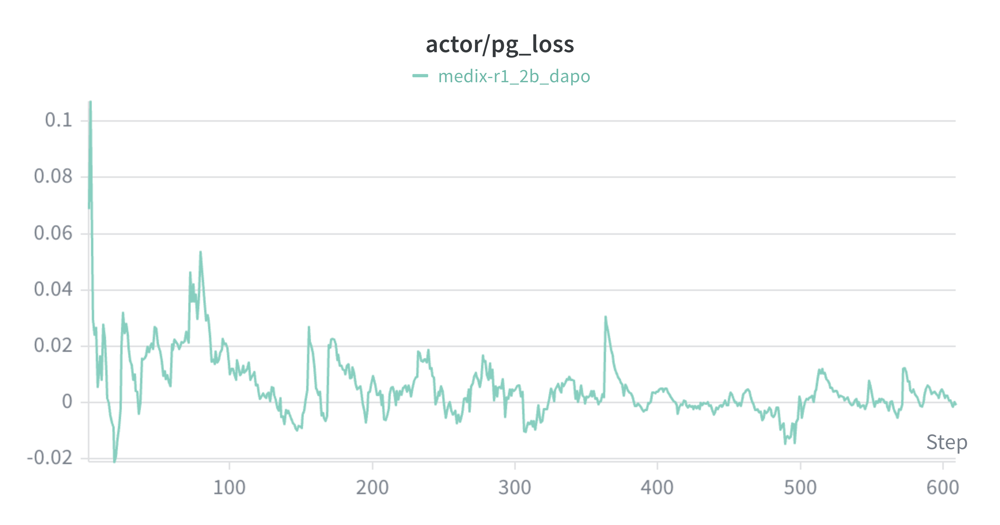
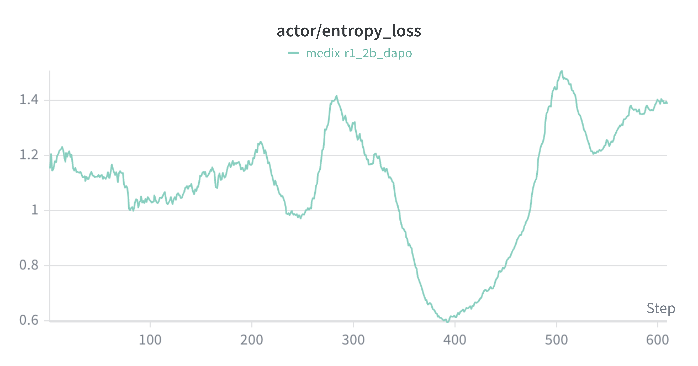
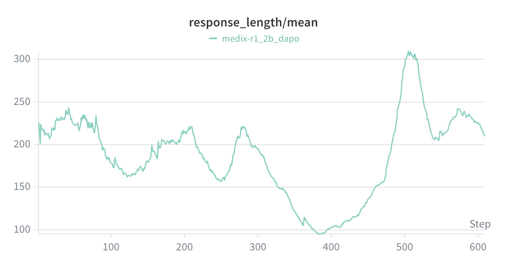
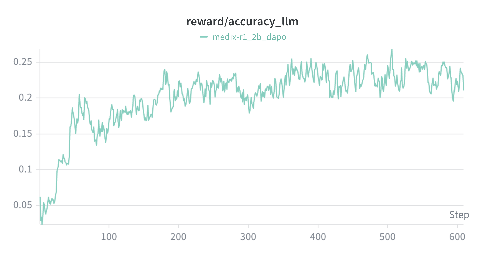
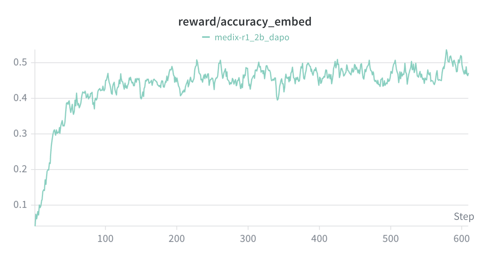
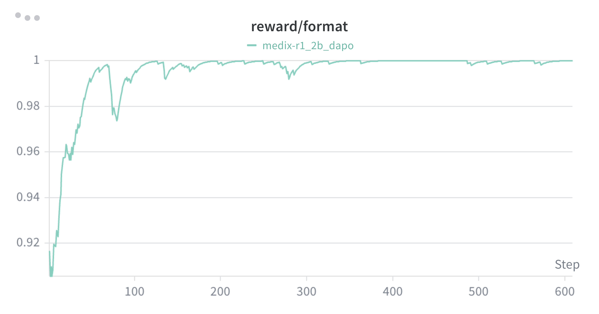
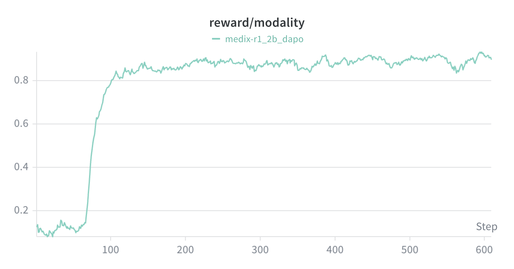
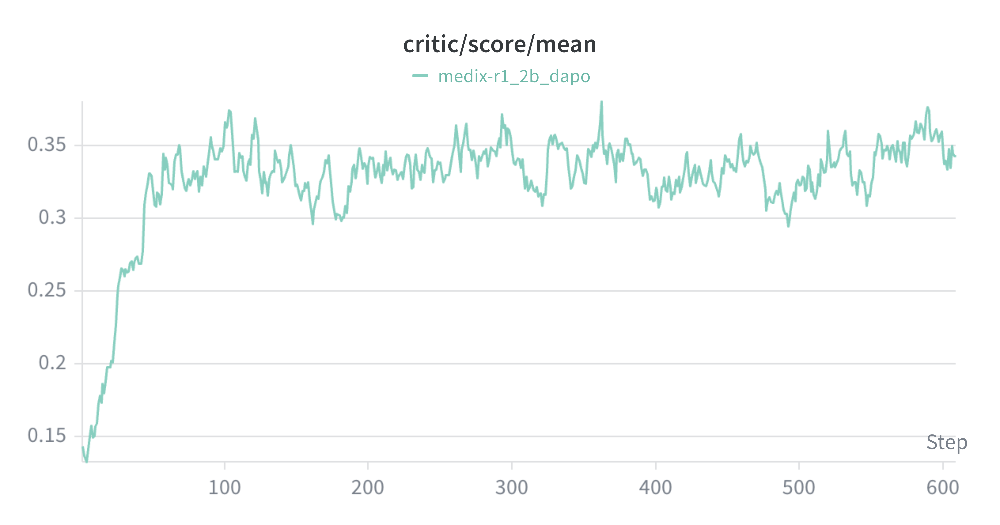

# MedVLM-RL 2B DAPO 训练指标分析报告

> 项目：MedReasonLab / MedVLM-RL  
> 基础模型：Qwen3-VL-2B-Instruct  
> 训练方法：GRPO 组内优势估计 + DAPO 风格优化（动态采样、Clip-Higher、Token 级损失）  
> 训练硬件：2 × NVIDIA RTX PRO 6000  
> 指标覆盖范围：约 600 个训练 Step

本报告分析训练过程中记录的策略损失、策略熵、响应长度及四项复合奖励。曲线数值采用图中读数，约数用“约”表示；对曲线的描述与可能原因分别说明。

---

## 1. 策略梯度损失（`actor/pg_loss`）

Policy Gradient Loss（策略梯度损失）是策略更新的优化目标之一。

- **Step 0–50：** 损失从约 0.10 下降，并出现较大波动。
- **Step 50–300：** 主要在 0–0.03 附近波动，偶有短暂上升。
- **Step 300–600：** 损失接近零，波动幅度整体减小。

**分析：** 在使用组内标准化优势和 PPO 风格裁剪目标的训练中，平均策略损失接近零并不等价于梯度范数接近零，也不能单凭该指标认定模型已经收敛。应结合奖励、策略熵、裁剪比例与独立评测判断训练效果。

## 2. 策略熵（`actor/entropy_loss`）

策略熵用于观察生成分布的不确定性与探索程度。

- **Step 0–200：** 熵总体在约 1.0–1.4 的范围内变化。
- **Step 200–400：** 出现明显下降，低点约 0.6。
- **Step 400–600：** 熵逐渐回升至约 1.4。

**分析：** 熵下降与同期响应长度缩短同时出现，提示模型生成行为阶段性地更集中。之后两项指标均回升，表明生成分布又发生了变化。这是值得分析的训练现象，但不能仅凭两条曲线将其认定为策略坍缩，或断言恢复由动态采样、Clip-Higher 中的某一机制单独造成。

## 3. 平均响应长度（`response_length/mean`）

该指标反映每批采样回答的平均生成 Token 数。

- **Step 0–100：** 从约 220 Token 下降至约 165 Token。
- **Step 200–400：** 继续缩短，最低约 95 Token。
- **Step 400–550：** 快速回升，最高约 305 Token。
- **训练末期：** 回落至约 220 Token。

**分析：** 响应长度与策略熵具有相近的阶段变化，说明模型在训练过程中明显调整了回答长度。较短回答是否影响医学答案完整性、是否更容易获得格式奖励，需要结合逐样本回答才能判断，不能仅由长度曲线得出结论。

## 4. 复合奖励分项

### 4.1 LLM 正确性奖励（`reward/accuracy_llm`）

该奖励通过 LLM Judge（大模型评判器）判断预测答案与参考答案是否语义匹配。

- 初始值约 0.03，在约 Step 150 上升至 0.22。
- 中后期主要在 0.20–0.25 区间波动。

**分析：** 训练期间，被评判为正确的比例有明显提高。该奖励是训练时的判断信号，与独立测试集 Accuracy（准确率）并非同一指标。

### 4.2 医学语义相似度奖励（`reward/accuracy_embed`）

该项使用 MedEmbed 对预测答案与参考答案编码，并以余弦相似度阈值 0.8 判定是否匹配。因此，图中记录的是**二值匹配奖励的平均值**，并非原始余弦相似度。

- 初始值约 0.03，在约 Step 150 上升至 0.45。
- 之后主要在 0.43–0.50 区间波动。

**分析：** 语义匹配奖励提升比 LLM 正确性奖励更快，且数值更高。两项指标使用的判定方法不同，不能直接将二者的数值差距解释为某项医学能力更强。

### 4.3 格式奖励（`reward/format`）

该奖励检查生成内容是否符合项目要求的结构化输出格式，包括 `<thinking>...</thinking>` 和 `<answer>...</answer>` 标签。

- 初始值约 0.90。
- 约 Step 100 后接近 1.0；在 Step 300 附近有轻微波动。

**分析：** 格式遵循率很快达到高位，说明训练中的回答大多满足结构检查。当同一问题组的回答格式奖励全部相同时，该分项对 GRPO 组内相对优势的区分作用会减弱；但不能笼统地说格式奖励从此不再产生训练影响。

### 4.4 图像模态匹配奖励（`reward/modality`）

该项判断输出的医学图像模态标签是否与参考模态相同，例如 X-ray、CT、MRI 等。

- **Step 70–130：** 奖励从约 0.10 快速提升至约 0.85。
- **Step 130–600：** 主要维持在 0.85–0.92 区间。

**分析：** 模态标签匹配率在早期出现明显阶跃式提高，之后保持高位。这表明模型较快改善了模态标签输出行为，但仅靠这项奖励不能衡量对病灶、解剖位置或临床含义的理解。

### 4.5 综合奖励（`critic/score/mean`）

虽然指标名称含有 `critic`，这里的 `critic/score/mean` 表示当前统计批次的平均综合奖励，并不意味着 2B GRPO 训练使用了独立的 Critic（价值模型）。

医疗奖励函数先为每条回答计算 `overall` 分数，再将其放入 `token_level_scores` 的最后一个有效响应 Token 位置。按 Token 维度求和可得到该回答的终局奖励，再在批次维度上计算均值。

默认权重如下：

| 分项 | 综合奖励中的系数 |
|---|---:|
| LLM 正确性奖励 | 0.9 × 0.575 = **0.5175** |
| 医学语义匹配奖励 | 0.9 × 0.375 = **0.3375** |
| 图像模态匹配奖励 | 0.9 × 0.05 = **0.0450** |
| 格式奖励 | **0.1000** |
| **合计** | **1.0000** |

因此：

\[
R = 0.5175 R_LLM + 0.3375 R_Embed + 0.045 R_Modality + 0.1 RFormat
\]

- **Step 0–100：** 综合奖励从约 0.13 上升至约 0.35。
- **Step 100–600：** 主要在 0.30–0.38 区间波动，中心约 0.34。

**分析：** 综合奖励在训练早期提升较快，随后进入波动平台期。由于该指标依赖采样题目与奖励评判机制，它适合观察训练动态，但不应替代独立测试集的效果评价。

---

## 5. 训练后评测：VQA-RAD

训练检查点 `global_step_600` 的 VQA-RAD（放射医学视觉问答）评测记录保存在 `../../evaluation/results/` 对应的结果目录中。

| 指标 | 结果 |
|---|---:|
| 评测问题数 | 451 |
| 判为正确的问题数 | 223 |
| Accuracy（准确率） | **49.45%** |

## 6. 总结

本次 MedVLM-RL 2B 后训练表现出以下主要现象：

1. 模态标签与格式奖励在早期快速提升，随后维持高位。
2. LLM 正确性奖励和医学语义匹配奖励总体提高，但在中后期进入波动区间。
3. 策略熵和响应长度在约 Step 200–400 同时下降，并在后续阶段回升。
4. 综合奖励在前约 100 步提升显著，之后趋于平台期。
5. Step-600 检查点在 451 条 VQA-RAD 评测记录上得到 **223/451（49.45%）**。

